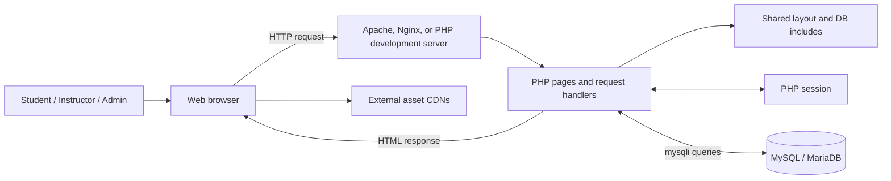
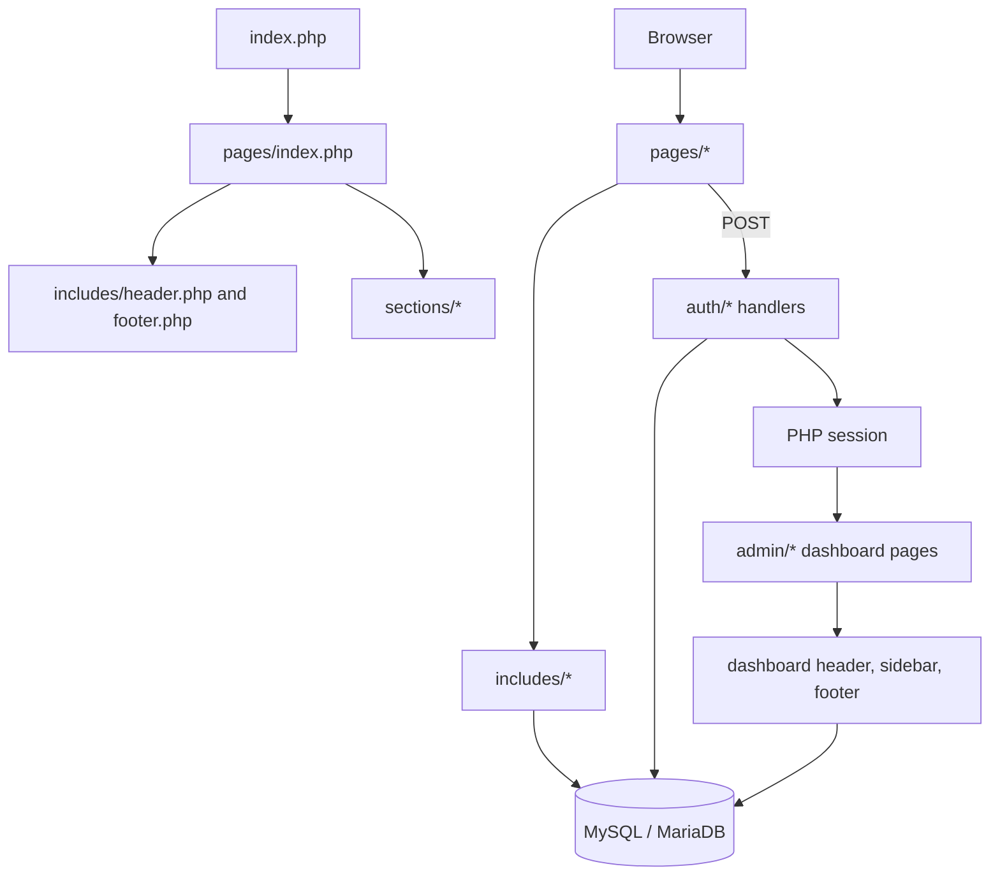
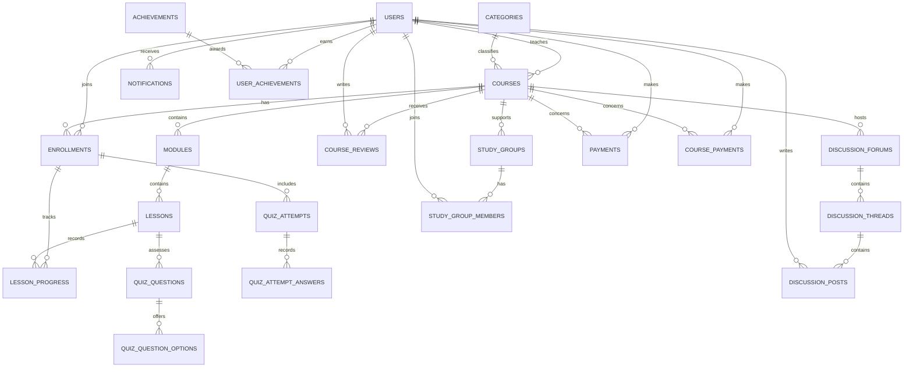

# SmartLearn System Design and Architecture

## 1. Purpose and scope

This document describes the current SmartLearn implementation. It distinguishes implemented behavior from UI prototypes and recommendations so it can be used as a realistic baseline for future development.

## 2. System overview

SmartLearn is a server-rendered PHP learning-management application. PHP pages produce HTML, PHP sessions hold authentication state, and MySQL/MariaDB stores user and learning data. Bootstrap, Font Awesome, and Google Fonts are loaded from external CDNs.

### Runtime components

| Component | Current responsibility |
|---|---|
| `index.php` | Redirects the site root to `pages/index.php`. |
| `pages/` | Public landing, login, registration, course, lesson, and subscription pages. |
| `auth/` | Handles login, registration, and logout HTTP requests. |
| `admin/` | Contains administrator, instructor, and student dashboard pages. The directory name is organizational; the pages are not consistently protected by server-side role checks. |
| `includes/` | Shared public/dashboard layout, sidebar, and `mysqli` database connection. |
| `sections/` | Reusable landing-page content fragments. |
| `assets/` | CSS, JavaScript, and image assets. |
| `database/Smartlearn.sql` | Database DDL, indexes, and seed data. |
| `database/migrations/` | Incremental database changes required by newer features. |
| MySQL/MariaDB | Persistent user, course, enrollment, assessment, payment, discussion, and related records. |

## 3. Application structure

The current application uses a page-oriented PHP structure with shared includes, rather than a formal MVC framework or separate API/backend service.

`includes/db_config.php` creates a `mysqli` connection and selects the `utf8mb4` character set. Database connection values are currently defined in the PHP file, including a machine-specific XAMPP socket path.

## 4. Main request flows

### Registration

1. The browser submits the registration form to `auth/handle_register.php`.
2. The handler validates required fields, email format, password length, selected role, and terms acceptance.
3. It checks for an existing email using a prepared statement.
4. It hashes the password using PHP `password_hash()`.
5. It inserts a student as `active` or an instructor as `pending_approval`.
6. On success it redirects to the login page; on validation failure it saves error/form data in the PHP session and redirects back to registration.

### Login

1. The browser submits email and password to `auth/handle_login.php`.
2. The handler looks up the user by email with a prepared statement.
3. It rejects suspended/deleted accounts and pending non-student accounts.
4. It verifies the password hash with `password_verify()`.
5. On success it regenerates the session ID, writes user identity and role into the session, updates `last_login_at`, and redirects based on role.
6. Logout clears session data, expires the session cookie, destroys the session, and redirects to login.

### Course and dashboard pages

Pages render HTML on the server and include shared layout fragments. Some pages query the database, but several current course and dashboard screens use hard-coded demonstration data. These pages should not be treated as evidence that the end-to-end learning workflows are implemented.

## 5. Data design

The SQL schema contains these logical areas:

| Area | Tables |
|---|---|
| Identity and platform | `users`, `notifications`, `system_settings`, `subscribers`, `testimonials` |
| Course catalog | `categories`, `courses`, `course_what_you_learn`, `modules`, `lessons` |
| Enrollment and progress | `enrollments`, `lesson_progress`, `user_notes` |
| Assessment | `quiz_questions`, `quiz_question_options`, `quiz_attempts`, `quiz_attempt_answers`, `assignment_submissions` |
| Commerce and feedback | `payments`, `course_payments`, `course_reviews` |
| Community | `discussion_forums`, `discussion_threads`, `discussion_posts`, `study_groups`, `study_group_members` |
| Gamification | `achievements`, `user_achievements` |

### Logical relationship view

The following relationships are inferred from the schema's key columns and index names. They are **not all enforced as database foreign-key constraints** in the current SQL dump.

The SQL dump defines primary keys, unique indexes, and supporting indexes, but it does not declare `FOREIGN KEY` constraints. Consequently, referential integrity currently depends on application behavior rather than the database.

## 6. Deployment view

### Local development

- PHP 7.4 or later with `mysqli`
- PHP cURL extension enabled for Paystack and exchange-rate API requests
- MySQL or MariaDB with the `Smartlearn` schema imported
- Apache/Nginx with PHP, or PHP's built-in development server
- Browser access to the project root

The checked-in connection configuration currently targets local XAMPP MariaDB through `/opt/lampp/var/mysql/mysql.sock`. That path is specific to one development environment and is not portable to a different host without configuration changes.

### Paystack course payments

- Apply `database/migrations/20261014_create_course_payments.sql` to existing databases. The updated `database/Smartlearn.sql` also includes the new table for fresh imports.
- Configure the server environment variables `PAYSTACK_SECRET_KEY` and `PAYSTACK_CALLBACK_URL`. The callback URL must be the public HTTPS URL of `pages/paystack_callback.php`; use Paystack test credentials for testing and never expose the secret key to browser code.
- Course prices are stored in USD. At checkout, the selected supported currency is converted using the current USD exchange rate from ExchangeRate-API; the converted amount and rate are stored with the pending payment.
- Enrollment is granted only after the callback handler verifies the reference, amount, currency, and successful status directly with Paystack. Currency availability still depends on the merchant's Paystack account.
- Instructors add YouTube watch URLs as video lessons. Enrolled students get the course playlist; only lessons explicitly marked previewable are available before enrollment.

### Production boundary

The current repository does not define a production deployment pipeline, environment-based secret management, background worker, API gateway, or external file-storage service. Those should be designed explicitly before production deployment.

## 7. Security and reliability boundaries

- Passwords are stored as password hashes, and the login/register lookups use prepared statements.
- Login regenerates the session ID after successful authentication.
- The public registration handler permits student and instructor roles, but not admin role.
- Dashboard pages currently include demonstration/mock values and do not consistently enforce authentication and role authorization at the page boundary. A redirect from login is not an access-control mechanism.
- Database credentials are hard-coded in `includes/db_config.php`; the current root/empty-password configuration is suitable only for local development and should not be used in production.
- There is no explicit CSRF protection visible in the inspected authentication forms/handlers.
- The SQL dump lacks database foreign-key constraints.
- External CDN assets require network access and introduce an external runtime dependency.

## 8. Known implementation gaps

1. **Prototype pages:** course browsing and dashboard metrics include static arrays or literal sample values; database-backed workflows are incomplete.
2. **Authorization:** introduce a shared authentication guard and role checks for every protected page and action.
3. **Configuration:** move credentials, host, port, and socket settings into environment-specific configuration; provide a safe example config without secrets.
4. **Schema integrity:** add and test foreign-key constraints and suitable delete/update rules.
5. **Security controls:** add CSRF protection, session cookie hardening, validation/error handling, and account recovery flows.
6. **Maintainability:** separate request handling, business rules, data access, and rendering as the application grows; centralize path generation and database access.
7. **Verification:** add automated tests for registration/login/logout, authorization boundaries, and database-backed course/progress flows.

## 9. Recommended evolution path

Keep the current PHP/MySQL deployment model for the next iteration and improve it incrementally:

1. Establish configuration and deployment conventions.
2. Add shared authentication/authorization guards and tests.
3. Replace mock dashboard/catalog data with database queries.
4. Add database foreign keys and migration/versioning practices.
5. Extract repeated SQL and business logic into small shared service/repository modules.
6. Add CSRF protection, structured logging, and backup/restore procedures.

This path avoids introducing a new framework or service architecture before the existing core workflows and security boundaries are complete.
